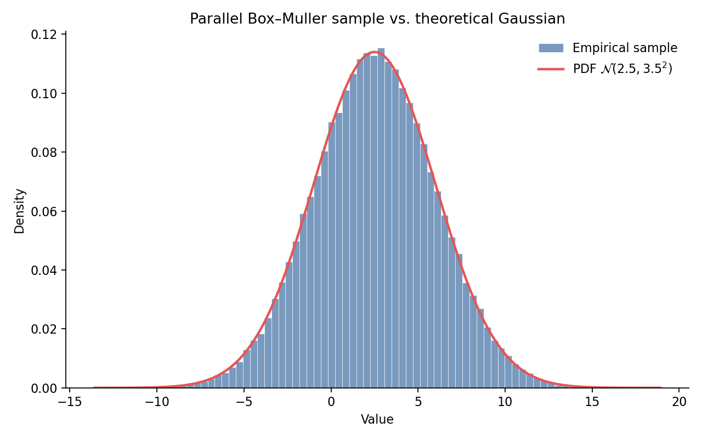

# Parallel Gaussian Sampler (MPI)

Monte Carlo sampling of $\mathcal{N}(\mu, \sigma^2)$ distributed across MPI ranks, with a Python check against the theoretical density.

This repository is a portfolio case study: a small numerical workload rewritten with clear module boundaries, correct collective communication, and a reproducible build/plot pipeline.

## What it does

1. Each MPI rank draws a share of $N$ independent normals via the Box–Muller (Marsaglia polar) transform.
2. Rank 0 gathers the local buffers with `MPI_Gatherv` and writes a single sample file.
3. A Python script overlays the empirical histogram on

$$
f(x) = \frac{1}{\sigma\sqrt{2\pi}}\, e^{-(x-\mu)^2 / (2\sigma^2)}.
$$

## Layout

```text
src/
  box_muller.c          Box–Muller transform
  include/box_muller.h
  sampler.c             MPI driver (partition → draw → gather → write)
  examples/             Minimal hello-world and send/recv programs
scripts/
  plot_distribution.py  Histogram vs. PDF
docs/
  case-study.md         Problem statement, math, and design notes
output/                 Generated samples and figures (gitignored)
```

## Requirements

- C compiler with MPI (`mpicc`, Open MPI or MPICH)
- Python 3 with `numpy` and `matplotlib` (`pip install -r requirements.txt`)

## Quick start

```bash
make demo
# equivalent to:
#   make
#   mpiexec -n 4 ./bin/sampler 100000 2.5 3.5 output/sample.dat
#   python3 scripts/plot_distribution.py --mu 2.5 --sigma 3.5
```

Override defaults as needed:

```bash
make run N=500000 MU=0 SIGMA=1 NP=8
make plot MU=0 SIGMA=1
```

`make run` uses `mpiexec --oversubscribe` so the demo works on a single workstation core count.

## Example result



Example programs:

```bash
make examples
mpiexec -n 2 ./bin/mpi_hello
mpiexec -n 2 ./bin/mpi_send_recv
```

## Improvements over the original exercise

| Before | After |
| --- | --- |
| Every rank wrote `sample.dat` concurrently | Single gather + single writer on rank 0 |
| `malloc(sizeof(double *) * N)` | Correct `sizeof(double)` allocation |
| Shared RNG stream across ranks | Per-rank seeding |
| Hard-coded plot labels / deprecated `normed` | CLI-driven plot with `density=True` |
| Binary artifacts and cluster PBS scripts in tree | Source-only layout, `.gitignore`, portable `Makefile` |

## Further reading

See [docs/case-study.md](docs/case-study.md) for the sampling model, the parallel partition, and validation notes.
